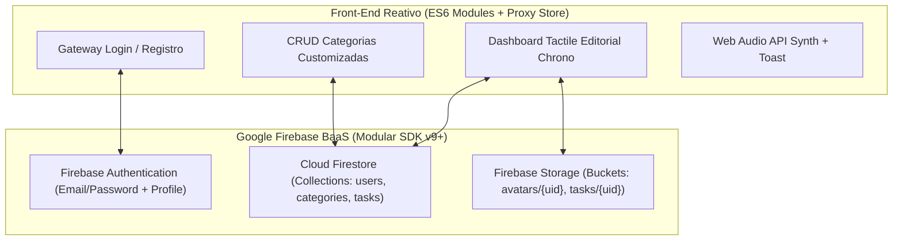

# CHRONO // TM-02 — Plataforma Multi-Usuário de Gerenciamento de Tarefas (Firebase Edition)

> Evolução Full-Stack BaaS do **CHRONO** com estética **Tactile Editorial Chrono** (inspiração Braun ET66 / Linear), utilizando **Firebase Authentication**, **Cloud Firestore (Multi-Tenant)**, **Firebase Storage (Upload de Imagens)** e arquitetura reativa **ES6 Proxy** em JavaScript Puro.

---

## 1. Visão Geral da Arquitetura Multi-Tenant (SDK v9+ Modular)



- **Isolamento Estrito por Usuário (`One-to-Many`):** Nenhum dado é global. Todas as consultas no Cloud Firestore utilizam `where("userId", "==", currentUser.uid)` combinadas com listeners em tempo real (`onSnapshot`).
- **Modo Híbrido de Contingência Local:** Enquanto as chaves em `firebase-config.js` estiverem vazias, a plataforma ativa automaticamente um motor multi-usuário local isolado por `uid` com suporte a upload via `FileReader` (Data URL), permitindo testar todo o fluxo imediatamente antes de conectar ao Firebase Console.
- **Arquitetura CSS Modularizada (`styles/`):** Folhas de estilo desacopladas por responsabilidade (`tokens.css`, `base.css`, `auth.css`, `layout.css`, `components.css`, `cards.css` e `responsive.css`) e orquestradas via `style.css`.

---

## 2. Modelo de Dados NoSQL (Cloud Firestore)

### Collection: `users/{uid}`
Armazena os metadados de perfil de cada conta autenticada.
| Campo | Tipo | Descrição |
| :--- | :--- | :--- |
| `uid` | `string` | Identificador único do Firebase Authentication (Chave primária do documento) |
| `name` | `string` | Nome de exibição do operador |
| `email` | `string` | E-mail de login do usuário |
| `photoURL` | `string` | URL pública do avatar armazenado no Firebase Storage (ou SVG fallback) |
| `createdAt` | `number` | Timestamp Unix (ms) de criação do perfil |

### Collection: `categories/{categoryId}`
Armazena as categorias personalizadas criadas, editadas ou excluídas pelo usuário.
| Campo | Tipo | Descrição |
| :--- | :--- | :--- |
| `userId` | `string` | Chave estrangeira lógica apontando para `users/{uid}` |
| `name` | `string` | Nome da categoria (ex: *Sprint Q4*, *Laboratório*, *Pessoal*) |
| `color` | `string` | Código hexadecimal da cor escolhida pelo usuário (ex: `#d97706`) |
| `createdAt` | `number` | Timestamp Unix (ms) para ordenação estável |

### Collection: `tasks/{taskId}`
Armazena as tarefas individuais pertencentes ao usuário, incluindo anexos visuais.
| Campo | Tipo | Descrição |
| :--- | :--- | :--- |
| `userId` | `string` | Chave estrangeira lógica apontando para `users/{uid}` |
| `title` | `string` | Título sanitizado da operação |
| `description` | `string` | Especificação detalhada da tarefa |
| `deadline` | `string` | Data/hora limite em formato ISO (`YYYY-MM-DDTHH:mm`) |
| `categoryId` | `string` | Referência ao documento em `categories/{categoryId}` |
| `categoryName` | `string` | Nome desnormalizado da categoria para leitura rápida |
| `categoryColor` | `string` | Cor desnormalizada da categoria |
| `priority` | `string` | `'Baixa'` \| `'Média'` \| `'Alta'` |
| `imageUrl` | `string` | URL da imagem anexada no Firebase Storage (`tasks/{uid}/{timestamp}_{filename}`) |
| `completed` | `boolean` | Estado de conclusão da tarefa |
| `notified` | `boolean` | Flag anti-repetição do motor de lembretes |
| `createdAt` | `number` | Timestamp Unix (ms) de criação |

---

## 3. Regras de Segurança Recomendadas (Security Rules)

### Cloud Firestore (`firestore.rules`)
```javascript
rules_version = '2';
service cloud.firestore {
  match /databases/{database}/documents {
    // Perfil do próprio usuário
    match /users/{userId} {
      allow read, write: if request.auth != null && request.auth.uid == userId;
    }

    // Categorias personalizadas (One-to-Many por userId)
    match /categories/{categoryId} {
      allow read, update, delete: if request.auth != null && resource.data.userId == request.auth.uid;
      allow create: if request.auth != null && request.resource.data.userId == request.auth.uid;
    }

    // Tarefas do usuário (One-to-Many por userId)
    match /tasks/{taskId} {
      allow read, update, delete: if request.auth != null && resource.data.userId == request.auth.uid;
      allow create: if request.auth != null && request.resource.data.userId == request.auth.uid;
    }
  }
}
```

### Firebase Storage (`storage.rules`)
```javascript
rules_version = '2';
service firebase.storage {
  match /b/{bucket}/o {
    match /avatars/{userId}/{allPaths=**} {
      allow read, write: if request.auth != null
                         && request.auth.uid == userId
                         && request.resource.size < 5 * 1024 * 1024
                         && request.resource.contentType.matches('image/.*');
    }

    match /tasks/{userId}/{allPaths=**} {
      allow read, write: if request.auth != null
                         && request.auth.uid == userId
                         && request.resource.size < 5 * 1024 * 1024
                         && request.resource.contentType.matches('image/.*');
    }
  }
}
```

---

## 4. Como Configurar e Executar

1. Abra o arquivo [`firebase-config.js`](./firebase-config.js) e cole as chaves do seu projeto obtidas no [Firebase Console](https://console.firebase.google.com/).
2. Sirva o diretório via servidor HTTP local (indispensável para carregar ES Modules `type="module"`):
   ```bash
   npx serve .
   # ou
   python -m http.server 8080
   ```
3. Acesse `http://localhost:8080` no navegador.
